# Engineering Portfolio
Mechanical engineering student and Engineering & Technology Intern at Baker Hughes, working where analysis, testing, and hardware meet: pump performance, thermo-fluids, and competition rocketry.

[About](#about-me) • [Resume](#resume) • [Experience](#engineering-experience) • [Featured Project](#featured-project--irec-competition-rocket) • [Projects](#selected-engineering-projects) • [Lab Work](#featured-lab-reports) • [Skills](#skills) • [Contact](#contact)

---

## About Me

I am a Mechanical Engineering student at the University of Texas Permian Basin, graduating in December 2026, focused on energy systems, thermo-fluids, experimental testing, and mechanical design. I like work that connects engineering analysis to real hardware and measured data.

I am currently an **Engineering & Technology Intern at Baker Hughes** in Midland, TX, where I analyze electric submersible pump (ESP) performance, build and test Python engineering tools, and support dismantle, inspection, and failure analysis (DIFA) of returned pumps.

From August 2024 to June 2026, I was **Aerodynamic Design Lead** for the Falcon Aeronautics & Space Team (FAST), leading fin-can and aerodynamic design for the team's 10,000-ft competition rocket, flown at IREC and the Lone Star Cup. I now mentor the team on rocket design and subsystem integration, and I am working on my senior design project, a 3D printing filament extruder.

I am looking for engineering roles where analysis, testing, and hardware come together, especially in energy, production, and fluid systems.

---

## Resume

📄 **[Download my resume (PDF)](assets/img/MarcosEsparza_Resume.pdf)**

---

## Engineering Experience

### Baker Hughes — Engineering & Technology Intern

**Location:** Midland, TX  
**Dates:** May 2026 – Present  
**Tools:** Python (pandas, NumPy, Matplotlib, SciPy, pytest), Git/GitHub, Excel

**ESP Performance Analysis**
- Developed a preliminary methodology for evaluating returned electric submersible pump (ESP) performance across seven newer-versus-legacy product-family comparisons, using shop PIT measurements of head, horsepower, efficiency, and vibration.
- Evaluated field oil, water, and gas production data separately as operating context.
- Applied runtime-matched and geographically controlled comparisons, validated outputs, reconciled engineering data, and presented findings, assumptions, and limitations to product-line engineers.

**ESP Design Intelligence**
- Defined engineering requirements and comparison logic, developed and verified Python workflows, and wrote software tests for an application used by application engineers in design reviews.
- Continuing to refine the tool based on engineering feedback.

**Equipment Inspection & Failure Investigation**
- Supported dismantle, inspection, and failure analysis (DIFA) of ESPs through hands-on component disassembly, cleaning, and inspection.
- Reviewed evidence of wear and discussed potential failure mechanisms with engineers, customers, and consultants.

---

## Featured Project — IREC Competition Rocket

**Role:** Aerodynamic Design Lead (Aug 2024 – Jun 2026); Mentor (Jun 2026 – Present)  
**Team:** Falcon Aeronautics & Space Team (FAST), UTPB  
**Tools:** SOLIDWORKS, MATLAB, OpenRocket, Excel

### Summary

Led aerodynamic and fin-can design for FAST's 10,000-ft collegiate competition rocket, flown at the Intercollegiate Rocket Engineering Competition (IREC) and the Lone Star Cup. The design was driven by real flight constraints: stable transonic flight, manufacturable hardware, clean subsystem integration, reliable recovery packaging, and enough flutter margin at peak velocity.

### Flight Results

- Telemetry-verified flights reached **8,869 ft at IREC** and **9,442 ft at the Lone Star Cup**.
- Coordinated airframe integration with the propulsion and recovery subteams for both flights.

### What I Did

- Designed fin geometry and evaluated static stability in OpenRocket and MATLAB.
- Developed a modular **4.02 in fiberglass airframe and 6061-T6 aluminum fin-can architecture** in SOLIDWORKS, including manufacturing drawings.
- Ran fin flutter analysis against a requirement of **at least 1.5× margin over maximum flight velocity**.
- Integrated recovery, internal structure, and avionics packaging into a single CAD workflow.
- Kept design decisions traceable through organized simulation, CAD, and GitHub records.

### Pre-Flight Simulation — L1500T

| Parameter | Value |
|---|---|
| Apogee | 10,990 ft |
| Maximum velocity | 1,191 ft/s (Mach 1.077) |
| Maximum acceleration | 431 ft/s² |
| Static stability margin | 2.76 cal |

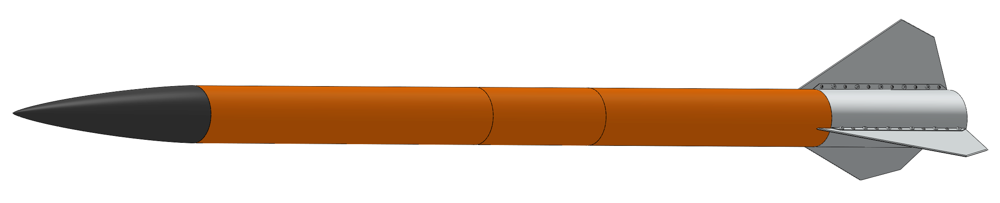

### Fin Flutter and Stability Analysis

I wrote a MATLAB tool that reads the OpenRocket trajectory, finds the maximum-velocity flight condition, and computes fin geometry ratios, static margin (with a Barrowman cross-check), and the Martin/Apogee flutter boundary. For the design iteration shown, the predicted flutter speed was about **2,650 ft/s, a 2.31× safety factor** over maximum velocity.

  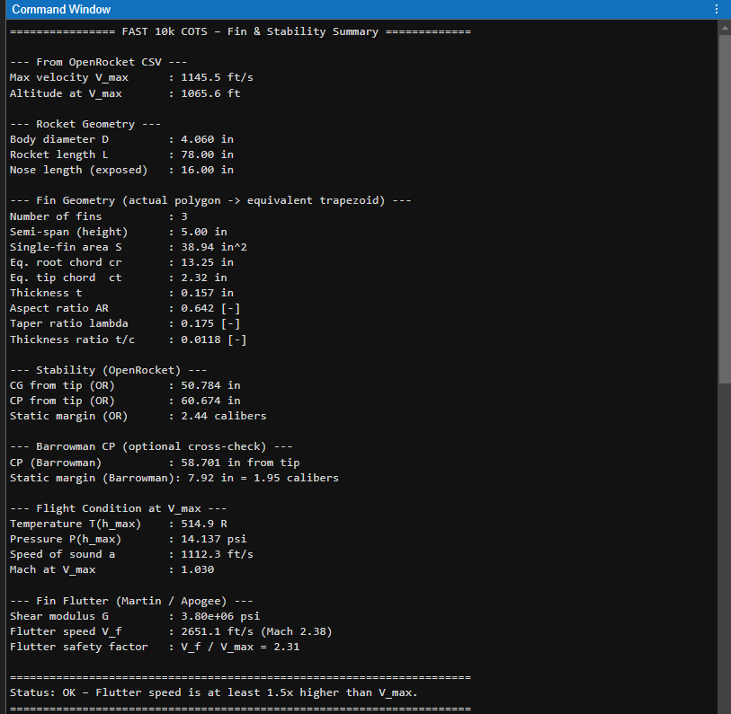

**Code:** [Fin flutter and stability script (MATLAB)](assets/files/fin_flutter_stability.m) • [FAST team repository version](https://github.com/MarcosEsparza/Falcon-Aeronautics-and-Space-Team/blob/main/simulations/matlab/fin_flutter/AluminumFinCan.m)

### Aluminum Fin Can Design

**Material:** 6061-T6 aluminum  
**Configuration:** Modular fin can integrated with the 4 in fiberglass airframe  
**Design goal:** Structural robustness and flutter margin for transonic flight

| Planform | Side | Isometric |
|:---:|:---:|:---:|
| 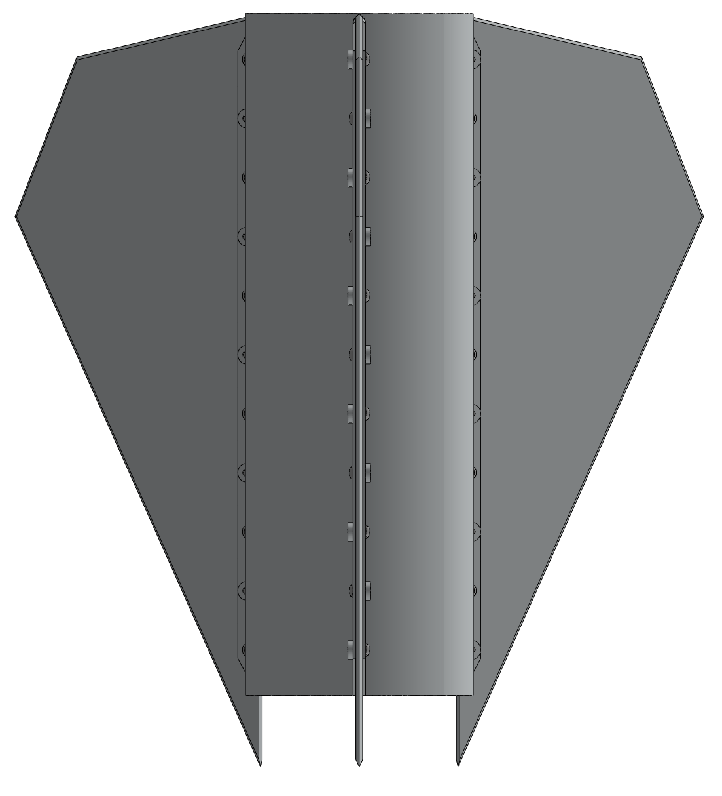 |  |  |

### Hardware Build

The vehicle went from simulation and CAD to fabricated, flight-ready hardware.

| Fin can | Airframe integration | Nose cone |
|:---:|:---:|:---:|
| 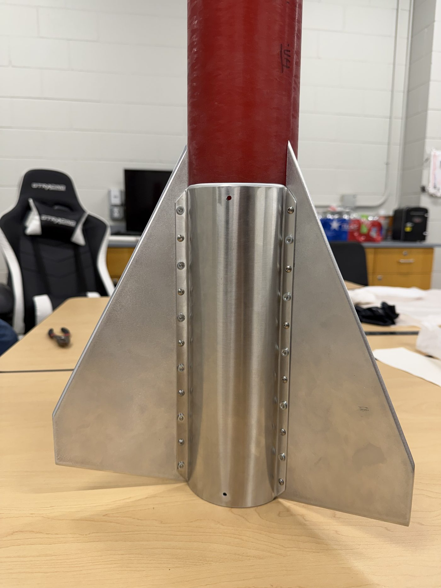 | 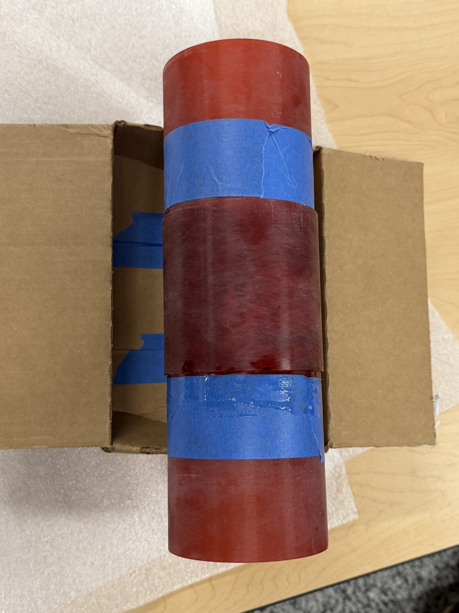 | 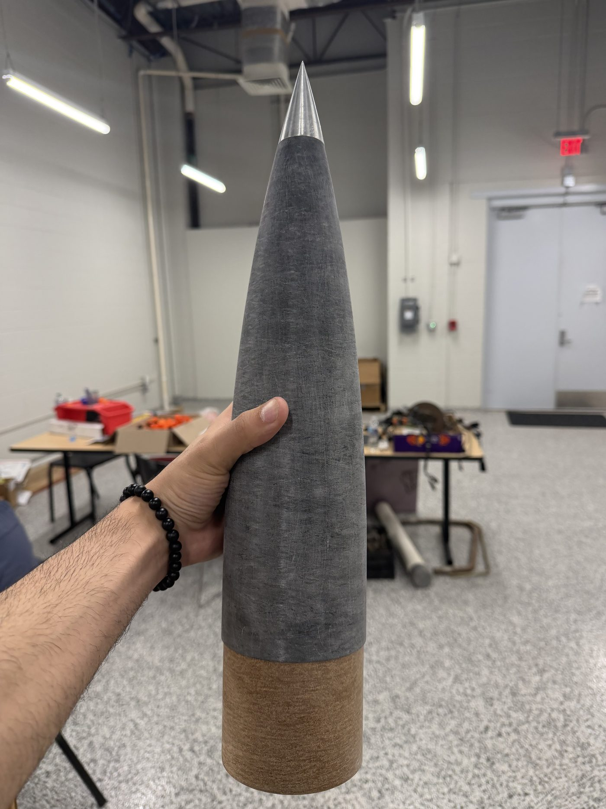 |

---

## Selected Engineering Projects

### 3D Printing Filament Extruder — Senior Design (In Progress)

**Phase:** Preliminary Design  
**Dates:** Aug 2026 – Present  
**Tools:** SOLIDWORKS, hand calculations

- Performed preliminary torque, power, gearing, extrusion-force, heater-sizing, heat-transfer, and shaft-loading calculations to guide motor selection.
- Developed motor CAD in SOLIDWORKS.
- Documented prototype manufacturing plans.

---

### Pipe Friction Reanalysis in Python

**Tools:** Python (pandas, NumPy, SciPy, Matplotlib, pytest), GitHub Actions

- Rebuilt my H408 fluid friction lab analysis as a small tested Python package from the report's raw data.
- Used one friction-factor convention throughout, solved Colebrook numerically, and propagated measurement uncertainty to every point.
- Found that the original rough-pipe comparison mixed Fanning and Darcy friction factors, and traced the remaining gap to a likely test-length error.

**Write-up:** [Pipe friction reanalysis](projects/pipe-friction-analysis/) • **Code:** [GitHub](https://github.com/MarcosEsparza/engineering-portfolio/tree/main/projects/pipe-friction-analysis)

  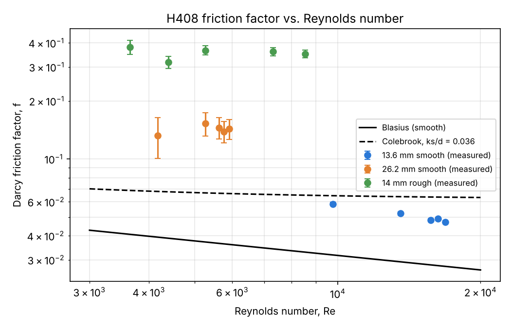

---

### Level 1 High-Power Rocket Certification

**Role:** Designer and Builder  
**Tools:** OpenRocket, hand calculations, fabrication and launch prep  
**Launch Site:** San Angelo, TX  
**Motor:** H219T-14

- Designed, built, and flew a Level 1 certification rocket.
- Reached **2,148 ft**, within about **2.4%** of the predicted altitude.

<video controls preload="none" poster="assets/img/l1-cert-flight-poster.jpg" style="width: 100%; max-width: 480px;">
  <source src="assets/video/l1-cert-flight.mp4" type="video/mp4">
  Your browser does not support the video tag.
</video>

---

### Level 2 Certification Rocket — In Progress

**Role:** Designer and Builder  
**Tools:** OpenRocket, CAD, avionics integration, recovery system planning

- Designing a **4 in dual-deploy Level 2 rocket** with dedicated drogue and main recovery bays.
- Simulated apogee of about **4,200 ft** on a **J425R-14** motor, with a target stability margin of about **1.9 cal**.
- Design work focuses on structural reliability, recovery sequencing, avionics integration, and repeatable field operations.

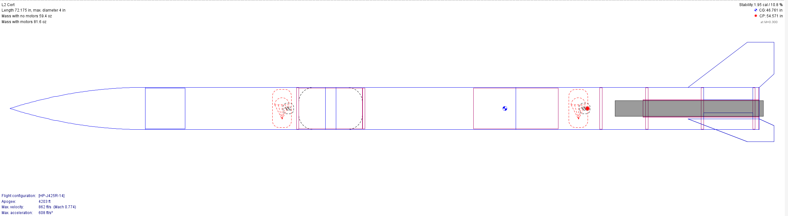

---

## Featured Lab Reports

Thermo-fluids and mechanical systems lab work at UTPB (Fall 2025 – Spring 2026). Beyond the reports below, I tested centrifugal and gear pumps and a reciprocating compressor using dynamometer instrumentation and data acquisition.

### Performance Analysis of a Turbojet Engine (SR-30 Mini-Lab)

**Tools:** SR-30 Mini-Lab, LabVIEW, DAQ, Excel, MATLAB

- Evaluated compressor-inlet and nozzle-exit flow conditions for an SR-30 turbojet.
- Estimated density, velocity, Mach number, and mass flow rate across the engine.
- Built a one-dimensional control-volume thrust model and compared it to measured thrust.
- Explained discrepancies in terms of non-ideal flow and instrumentation limits.

**Report:** [PDF](assets/docs/sr30-turbojet-performance.pdf)

  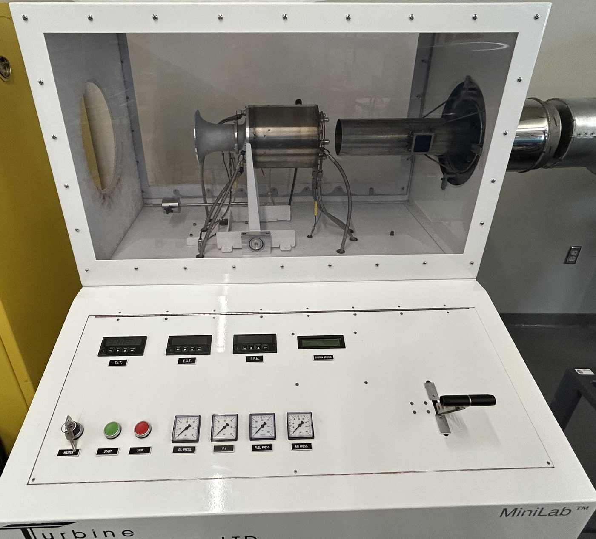

---

### Pelton Turbine – Performance and Efficiency

**Tools:** Pelton turbine rig, load cell, tachometer, Excel

- Measured turbine behavior across spear-valve positions and loading conditions.
- Generated torque-speed and power-speed curves.
- Calculated hydraulic power and overall efficiency.

**Report:** [PDF](assets/docs/lab02-pelton-turbine.pdf)

  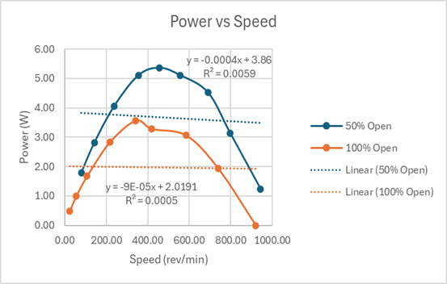

---

### Cross-Flow Heat Exchanger – TE93

**Tools:** TE93 rig, pitot-static measurements, DAQ, Excel

- Measured velocity and pressure behavior across a cross-flow rod bank.
- Compared results with theoretical trends and heat-transfer correlations.
- Interpreted convective behavior and flow losses.

**Report:** [PDF](assets/docs/lab06-cross-flow-heat-exchanger.pdf)

  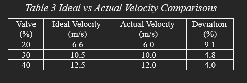

---

### Cooling Rate and Transient Convection

**Tools:** TE93 apparatus, thermocouples, DAQ, Excel

- Measured transient cooling of a heated copper rod under varying airflow.
- Used lumped-capacitance analysis to estimate convective heat-transfer coefficients.
- Compared results with correlation-based values.

**Report:** [PDF](assets/docs/lab07-cooling-rate.pdf)

  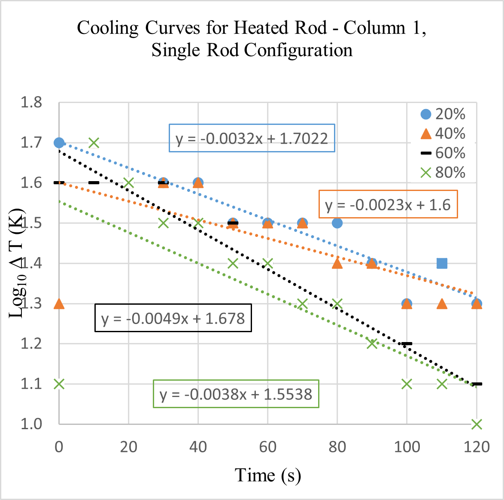

---

### Fluid Friction and Bend Loss – H408

**Tools:** H408 apparatus, pressure gauges, Excel

- Measured friction factors in smooth and rough pipes and across fittings.
- Calculated Reynolds number, head loss, and minor loss coefficients.
- Compared results with Moody and Blasius correlations.

**Report:** [PDF](assets/docs/lab03-fluid-friction.pdf) • **Python reanalysis:** [write-up](projects/pipe-friction-analysis/)

  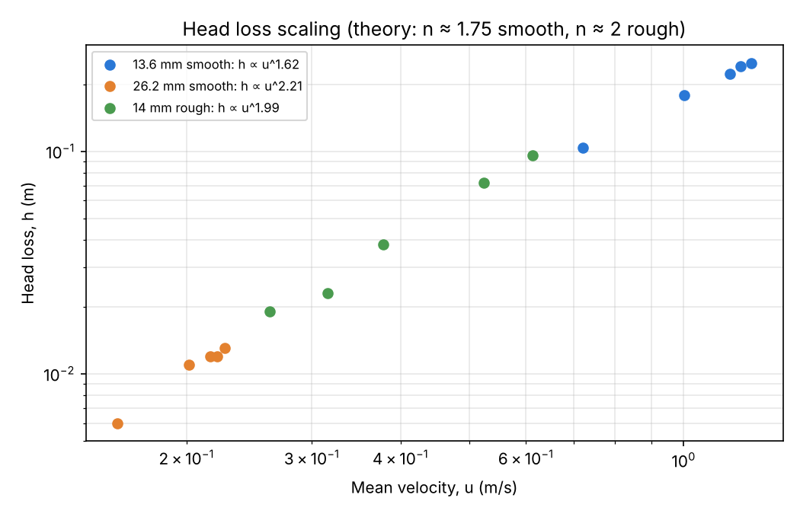

---

## Supporting Work

- **Flow Measuring Devices:** Compared orifice plates, Venturi meters, and rotameters; evaluated discharge coefficients and uncertainty. [PDF](assets/docs/lab05-flow-measuring-devices.pdf)
- **Bend Loss in Pipe Fittings:** Measured minor losses across fittings and compared with handbook values. [PDF](assets/docs/lab04-bend-loss.pdf)
- **Velocity Profile in Cross-Flow:** Mapped wake behavior and downstream velocity variation with pitot measurements. [PDF](assets/docs/lab08-velocity-profile.pdf)
- **Impact of a Jet:** Compared measured reaction forces with momentum theory. [PDF](assets/docs/lab01-impact-of-a-jet.pdf)
- **Charpy and Izod Impact:** Compared absorbed energy and fracture behavior of 3D-printed polymers. [PDF](assets/docs/lab09-charpy-izod-impact.pdf)
- **Torsion Test:** Evaluated torque-angle response, shear modulus, and elastic-plastic shaft behavior. [PDF](assets/docs/lab10-torsion.pdf)
- **Carbon Fiber in Aerospace (team poster):** Materials selection for lightweight commercial aircraft structures. [PDF](assets/docs/carbon-fiber-in-aerospace-poster.pdf)

---

## Skills

**Programming & Data:** Python (pandas, NumPy, Matplotlib, SciPy, pytest; [example project](projects/pipe-friction-analysis/)), MATLAB, Git/GitHub  
**Software:** SOLIDWORKS, OpenRocket, Excel, LabVIEW / DAQ  
**Test & Lab:** Pump and compressor testing, dynamometer instrumentation, pressure and flow measurement, data acquisition and reduction  
**Analysis:** Pressure drop and head loss, heat transfer, turbomachinery performance, stability and flutter analysis  
**Fabrication:** Basic machining, hand tools, 3D printing, epoxy layups, rocket assembly and avionics integration  
**Certifications:** Basin United; NAR High-Power Rocketry Level 1 (Level 2 in progress)

---

## Organizations

- Falcon Aeronautics & Space Team (FAST) – Mentor, former Aerodynamic Design Lead
- ASME – Student Member
- AIAA – Student Member
- Society of Petroleum Engineers (SPE) – Student Member
- National Association of Rocketry – Member
- Tripoli Rocketry Association – Member

---

## Contact

- **Email:** [esparza_m58311@utpb.edu](mailto:esparza_m58311@utpb.edu)
- **LinkedIn:** [linkedin.com/in/marcos-v-esparza](https://www.linkedin.com/in/marcos-v-esparza/)
- **Resume:** [PDF](assets/img/MarcosEsparza_Resume.pdf)

[Back to Top](#engineering-portfolio)
