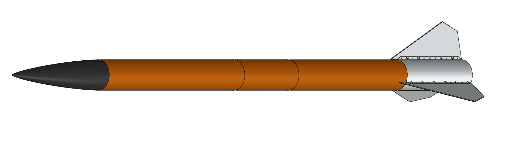
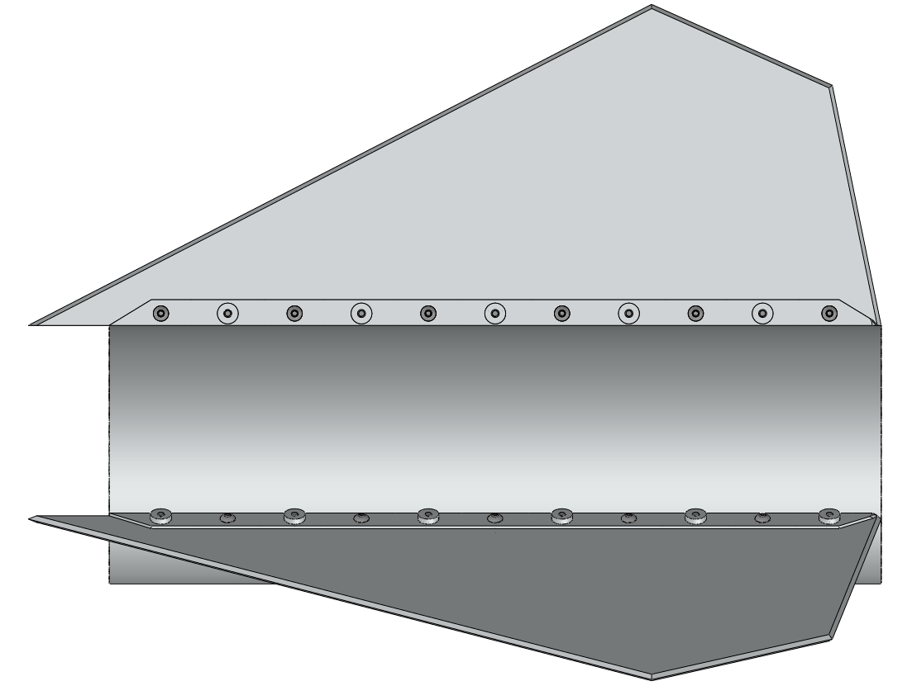
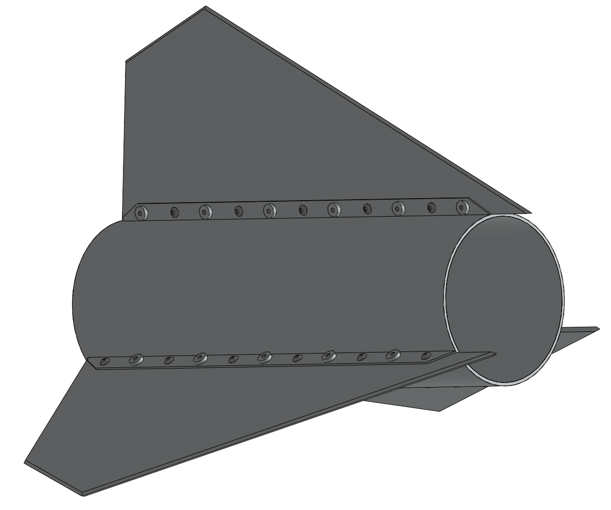
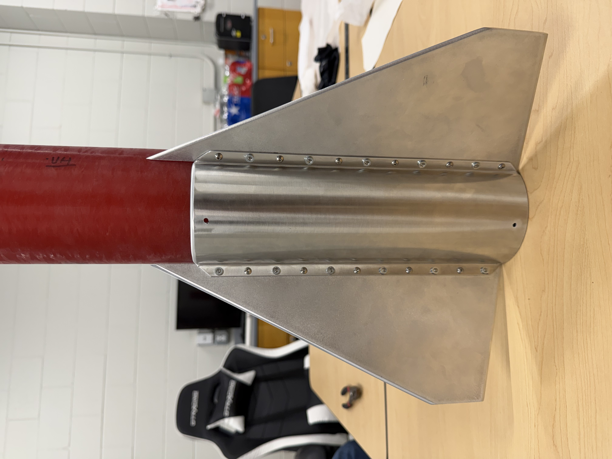
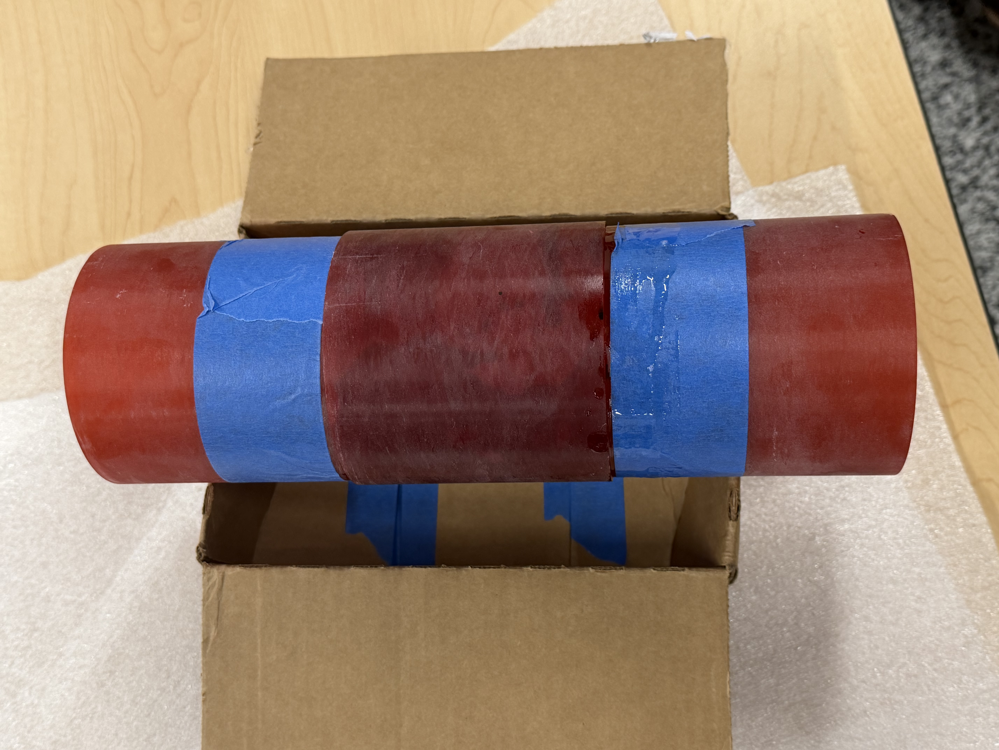
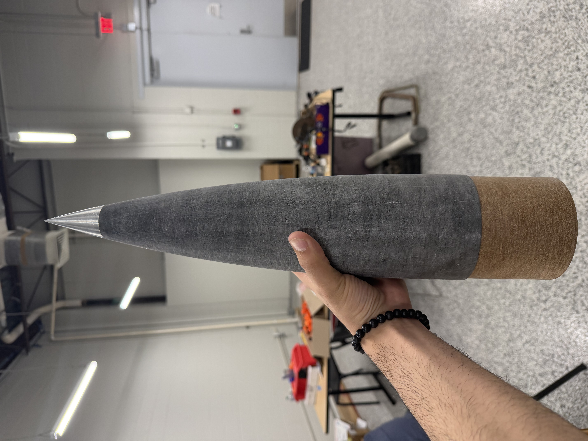
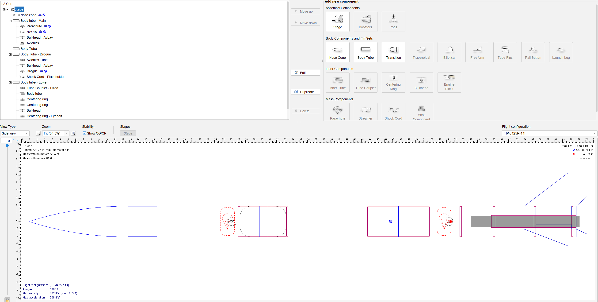
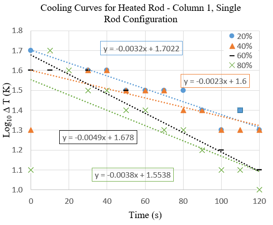
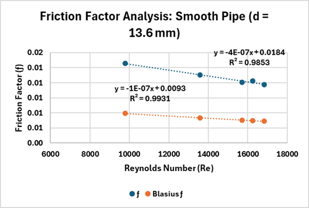

# Engineering Portfolio  
Mechanical Engineering Student | Energy Systems | Thermo-Fluids | Experimental Testing | Applied Design

[About](#about-me) • [Resume](#resume) • [Experience](#engineering-experience) • [Featured Project](#featured-project--irec-2026) • [Projects](#selected-engineering-projects) • [Lab Reports](#featured-lab-reports) • [Skills](#skills) • [Contact](#contact)

---

## About Me

I am a Mechanical Engineering student at the University of Texas Permian Basin, graduating in December 2026, with a technical focus on energy systems, thermo-fluids, experimental testing, and mechanical design. My work is centered on connecting engineering analysis to real hardware, measured data, and practical system performance.

I am currently an Engineering & Technology Intern at Baker Hughes in Midland, TX, where I work on electric submersible pump (ESP) performance analysis, Python-based engineering tools, and dismantle, inspection, and failure analysis (DIFA) of returned pumps.

From August 2024 to June 2026, I served as Aerodynamic Design Lead for the Falcon Aeronautics & Space Team (FAST), leading fin-can and aerodynamic development for the team's 10,000-ft competition rocket flown at IREC and the Lone Star Cup. I now mentor team members on rocket design and subsystem integration. This semester I am also working on my senior design project, a 3D printing filament extruder.

My laboratory and project experience includes pumps and compressors, cross-flow heat exchangers, fluid friction and bend losses, flow-measurement devices, transient cooling, turbomachinery performance, and rocket flight design. Across these projects, I have developed experience in pressure-drop analysis, heat transfer, data reduction, test interpretation, and engineering decision-making.

I am especially interested in engineering roles where analysis, testing, and hardware come together, particularly in energy, production, and fluid-based systems.

---

## Resume

📄 **[Download my resume (PDF)](assets/img/MarcosEsparza_Resume.pdf)**

---

## Engineering Experience

### Baker Hughes — Engineering & Technology Intern

**Location:** Midland, TX  
**Dates:** May 2026 – Present  
**Tools:** Python (pandas, NumPy, Matplotlib, SciPy, pytest), Git/GitHub, Excel

**ESP Performance Analysis**
- Developed a preliminary methodology for evaluating the performance of returned electric submersible pumps (ESPs) across seven newer-versus-legacy product-family comparisons, using shop PIT measurements of head, horsepower, efficiency, and vibration.
- Evaluated field oil, water, and gas production data separately as operating context.
- Applied runtime-matched and geographically controlled comparisons, validated outputs, reconciled engineering data, and presented findings, assumptions, and limitations to product-line engineers.

**ESP Design Intelligence**
- Defined engineering requirements and comparison logic, developed and verified Python workflows, and wrote software tests for an application used by application engineers in design reviews.
- Continuing to refine the tool based on engineering feedback.

**Equipment Inspection & Failure Investigation**
- Supported dismantle, inspection, and failure analysis (DIFA) of ESPs through hands-on component disassembly, cleaning, and inspection.
- Reviewed evidence of wear and discussed potential failure mechanisms with engineers, customers, and consultants.

---

## Featured Project — IREC 2026

**Role:** Aerodynamic Design Lead (Aug 2024 – Jun 2026); Mentor (Jun 2026 – Present)  
**Team:** Falcon Aeronautics & Space Team, UTPB  
**Tools:** SOLIDWORKS, MATLAB, OpenRocket, Excel

### Project Summary

Led aerodynamic and fin-can development for FAST's 10,000-ft collegiate competition rocket, flown at the Intercollegiate Rocket Engineering Competition (IREC) and the Lone Star Cup. The design was built around real flight constraints: stable transonic performance, manufacturable hardware, clean subsystem integration, reliable recovery packaging, and sufficient flutter margin at expected peak velocity.

### Flight Results

- Telemetry-verified flights reached approximately **8,800 ft** and **9,300 ft**.
- Coordinated airframe integration with the propulsion and recovery subteams for both flights.

### Engineering Scope

- Designed fin geometry and evaluated aerodynamic stability using MATLAB and OpenRocket.
- Developed a modular **4.02 in fiberglass airframe and aluminum fin-can architecture** in SOLIDWORKS, including manufacturing drawings.
- Performed fin flutter analysis with a target of **at least 1.5× maximum flight velocity margin**.
- Integrated recovery, internal structure, and avionics packaging into a unified CAD workflow.
- Supported technical documentation and design traceability through organized simulation, CAD, and GitHub records.

### Pre-Flight Simulation — L1500T

- **Apogee:** 10,990 ft  
- **Maximum velocity:** 1,191 ft/s (Mach 1.077)  
- **Maximum acceleration:** 431 ft/s²  
- **Static stability margin:** 2.76 cal  

### Aluminum Fin Can Design

**Material:** 6061-T6 aluminum  
**Configuration:** Modular fin-can integrated with 4 in fiberglass airframe  
**Design goal:** Structural robustness and flutter margin suitable for transonic flight

Planform view:  

Side view:  

Isometric view:  

**Related MATLAB Code:** [Fin Flutter Solver](https://github.com/MarcosEsparza/Falcon-Aeronautics-and-Space-Team/blob/main/simulations/matlab/fin_flutter/AluminumFinCan.m)

### Hardware Build Progress

The IREC vehicle went from simulation and CAD to fabricated, flight-ready hardware. These images show the rocket's fin can, airframe assembly, and nose cone hardware during the build.

**Fabricated fin can assembly**

  

*Figure: Fabricated aluminum fin can installed on the fiberglass airframe, showing the real fin-body interface and assembled hardware.*

**Airframe integration and assembly**

  

*Figure: Bonded airframe section during fabrication, documenting structural integration and physical build progress.*

**Nose cone hardware**

  

*Figure: Fiberglass nose cone with metallic tip and lower shoulder.*

---

## Selected Engineering Projects

### 3D Printing Filament Extruder — Senior Design (In Progress)

**Phase:** Preliminary Design  
**Dates:** Aug 2026 – Present  
**Tools:** SOLIDWORKS, hand calculations

- Performed preliminary torque, power, gearing, extrusion-force, heater-sizing, heat-transfer, and shaft-loading calculations to guide motor selection.
- Developed motor CAD in SOLIDWORKS.
- Documented prototype manufacturing plans.

---

### Level 1 High-Power Rocket Certification

**Role:** Designer and Builder  
**Tools:** OpenRocket, hand calculations, fabrication and launch prep  
**Launch Site:** San Angelo, TX  

- Designed, built, and successfully flew a Level 1 certification rocket.
- Reached **2,148 ft**, with approximately **2.4% error** relative to predicted altitude.
- Demonstrated strong agreement between simulation and actual flight performance.
- Motor used: **H219T-14**

<video width="480" controls>
  <source src="assets/img/IMG_4424.mp4" type="video/mp4">
  Your browser does not support the video tag.
</video>

---

### Level 2 Certification Rocket — In Progress

**Role:** Designer and Builder  
**Tools:** OpenRocket, CAD, avionics integration, recovery system planning

- Designing a **4 in dual-deploy Level 2 rocket** with dedicated drogue and main recovery bays.
- Current simulated apogee is approximately **4,200 ft** on a **J425R-14** motor.
- Current design work emphasizes structural reliability, recovery sequencing, avionics integration, and repeatable field operations.
- Current target stability margin is approximately **1.9 cal**.

---

## Featured Lab Reports

A selection of projects most relevant to thermo-fluids, energy systems, and experimental analysis. In Spring 2026, my thermo-fluids and mechanical systems lab work also included centrifugal and gear pump testing and reciprocating compressor testing using dynamometer instrumentation and data acquisition.

### Performance Analysis of a Turbojet Engine (SR-30 Mini-Lab)

**Role:** Lab Team Member  
**Tools:** SR-30 Mini-Lab, LabVIEW, DAQ, Excel, MATLAB

- Evaluated compressor-inlet and nozzle-exit flow conditions for an SR-30 turbojet.
- Estimated density, velocity, Mach number, and mass flow rate across the engine.
- Developed a one-dimensional momentum-based thrust model and compared prediction to measured thrust.
- Interpreted discrepancies in terms of non-ideal flow behavior and instrumentation limitations.

**Report:** [PDF](assets/img/Performance%20Analysis%20of%20a%20Turbojet%20Engine.pdf)

  

---

### Pelton Turbine – Performance and Efficiency

**Role:** Lab Team Member  
**Tools:** Pelton turbine rig, load cell, tachometer, Excel

- Measured turbine behavior under varying spear-valve positions and loading conditions.
- Generated torque-speed and power-speed relationships.
- Calculated hydraulic power and overall efficiency.
- Connected experimental behavior to turbomachinery performance fundamentals.

**Report:** [PDF](assets/img/Lab2%20Pelton%20Turbine.pdf)

  

---

### Cross-Flow Heat Exchanger – TE93

**Role:** Lab Team Member  
**Tools:** TE93 rig, pitot-static measurements, DAQ, Excel

- Measured velocity and pressure behavior across a cross-flow rod bank.
- Compared experimental behavior against theoretical trends and heat-transfer correlations.
- Applied thermo-fluids analysis to interpret convective behavior and flow losses.

**Report:** [PDF](assets/img/Lab6%20Cross%20Flow%20Heat%20Exchanger%20(1).pdf)

  

---

### Cooling Rate and Transient Convection

**Role:** Lab Team Member  
**Tools:** TE93 apparatus, thermocouples, DAQ, Excel

- Measured transient cooling of a heated copper rod under varying airflow conditions.
- Applied lumped-capacitance analysis to estimate convective heat-transfer coefficients.
- Compared experimental results to expected correlation-based values.

**Report:** [PDF](assets/img/Lab7%20Cooling%20Rate.pdf)

  

---

### Fluid Friction and Bend Loss – H408

**Role:** Lab Team Member  
**Tools:** H408 apparatus, pressure gauges, Excel

- Measured friction factors in smooth and rough pipes and across multiple fittings.
- Calculated Reynolds number, head loss, and minor loss coefficients.
- Compared results against standard correlations including Moody and Blasius trends.
- Related findings to piping systems, pump performance, and industrial fluid transport.

**Report:** [PDF](assets/img/Lab3%20Friction%20Fluid.pdf)

  

---

## Supporting Experimental Work

- **Flow Measuring Devices**  
  Compared orifice plates, Venturi meters, and rotameters; evaluated discharge coefficients and uncertainty.  
  **Report:** [PDF](assets/img/Lab5%20Flow%20Measuring%20Devices.pdf)

- **Bend Loss in Pipe Fittings**  
  Measured minor losses across fittings and compared experimental coefficients with handbook values.  
  **Report:** [PDF](assets/img/Lab%204%20Bend%20Loss.pdf)

- **Velocity Profile in Cross-Flow**  
  Mapped wake behavior and downstream velocity variation using pitot-based measurements.  
  **Report:** [PDF](assets/img/Lab8-Velocity%20Profile.pdf)

- **Impact of a Jet**  
  Investigated momentum transfer and compared measured reaction forces with theory.  
  **Report:** [PDF](assets/img/Lab1%20Impact%20of%20a%20Jet-1.pdf)

- **Impact: Charpy and Izod**  
  Compared absorbed energy and fracture behavior for multiple 3D-printed polymers.  
  **Report:** [PDF](assets/img/Lab9-Impact-Charpy%20and%20Izod.pdf)

- **Torsion Test**  
  Evaluated torque-angle response, shear modulus, and elastic-plastic shaft behavior.  
  **Report:** [PDF](assets/img/lab10-%20Torsion%20Lab%20Report.pdf)

---

## Skills

### Programming and Data
- Python (pandas, NumPy, Matplotlib, SciPy, pytest)
- MATLAB
- Git / GitHub

### Engineering Software
- SOLIDWORKS
- OpenRocket
- Excel
- LabVIEW / DAQ systems

### Analysis and Testing
- Experimental data reduction
- Pump and compressor testing with dynamometer instrumentation
- Pressure-drop and head-loss analysis
- Heat-transfer analysis
- Turbomachinery performance calculations
- Pressure and flow measurement and instrumentation
- Engineering plotting and technical reporting

### Fabrication
- Basic machining and hand tools
- 3D printing
- Epoxy layups
- Rocket assembly and avionics integration

### Design and Domain Areas
- Thermo-fluids and energy systems
- Rocket aerodynamic design
- Stability and flutter analysis
- Recovery system integration
- Mechanical design for manufacturable hardware

### Certifications
- Basin United
- National Association of Rocketry (NAR) Level 1 High-Power Certification
- Level 2 High-Power Certification in progress

---

## Organizations

- Falcon Aeronautics & Space Team (FAST) – Mentor
- ASME – Student Member
- AIAA – Student Member
- Society of Petroleum Engineers (SPE) – Student Member
- National Association of Rocketry – Student Member
- Tripoli Rocketry Association – Student Member

---

## Contact

- **Email:** esparza_m58311@utpb.edu  
- **LinkedIn:** [linkedin.com/in/marcos-v-esparza](https://www.linkedin.com/in/marcos-v-esparza/)

- **Resume:** [PDF](assets/img/MarcosEsparza_Resume.pdf)

[Back to Top](#engineering-portfolio)
